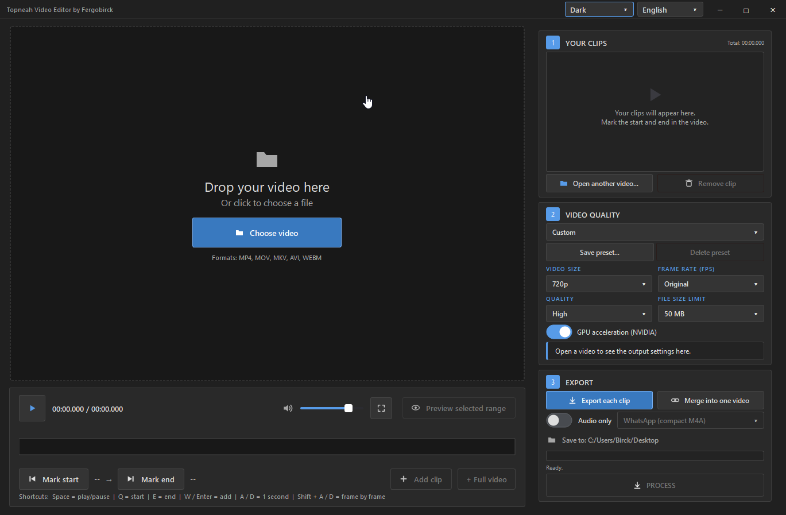

# Topneah Video Editor

A Windows video editor built with Python, PySide6, and FFmpeg. Cut clips, merge them into a single video, or extract audio, with a video preview and keyboard shortcuts.



*Dark theme, with the language selector next to the theme selector.*

## Features

- Open videos by dragging and dropping them or using the file picker.
- Mark clip start and end points, or add the entire video with one click.
- Reorder clips and choose which ones to export.
- Export each clip separately or merge selected clips into a single file.
- Extract audio as M4A, MP3, or WAV.
- Original, WhatsApp compact, WhatsApp HD, and Custom presets.
- Adjust resolution, frame rate, quality, and file size limits; save and delete your own presets.
- Set custom output dimensions while preserving the aspect ratio, with padding when needed.
- Support portrait videos, including orientation stored in rotation metadata.
- NVIDIA NVENC acceleration when available, with CPU fallback.
- Switch instantly between five themes: Dark, Light, Win9x, Win9x Flat, and Windows XP.
- English (default), Portuguese, and Spanish interfaces, with instant switching next to the theme selector.
- Remember the last language, theme, preset, and output directory.
- Fullscreen preview and a resizable application window.
- Open the output file or reveal it in File Explorer after processing.

## Installation

Requires **Windows and Python 3.12 or later**. Open PowerShell in the project folder and run:

```powershell
py -m venv .venv
.\.venv\Scripts\python.exe -m pip install --upgrade pip
.\.venv\Scripts\python.exe -m pip install PySide6 imageio-ffmpeg
.\.venv\Scripts\pythonw.exe app.pyw
```

The application uses FFmpeg from your `PATH` when available. Otherwise, it uses the executable provided by `imageio-ffmpeg`. The optional `ffprobe` tool is used to inspect videos when available on your `PATH`.

To open a video directly:

```powershell
.\.venv\Scripts\pythonw.exe app.pyw "C:\Videos\my-video.mp4"
```

## Usage

1. Drag a video into the window or click **Choose video**.
2. Navigate through the preview and press **Q** to mark the start and **E** to mark the end.
3. Press **W** or **Enter** to add the clip. To include the entire video, click **+ Full video** next to **Add clip**.
4. Repeat for additional clips. Drag list items to reorder them and use the checkboxes to choose which ones to process. The total in the header includes every clip in the list, including unchecked ones.
5. Choose a quality preset and an output folder.
6. Select **Export each clip**, **Merge into one video**, or enable **Audio only**, then click **PROCESS**.

When processing produces a single output file, the completion dialog offers **Open file**. **Open folder** reveals the selected file in File Explorer; when there are multiple outputs, it selects the last file generated.

## Keyboard shortcuts

| Key | Action |
| --- | --- |
| Space | Play / pause |
| A / D | Move backward / forward by 1 second |
| Shift + A / D | Previous / next frame |
| Q | Mark start |
| E | Mark end |
| W or Enter | Add clip |
| Esc | Exit fullscreen |
| Double-click the video | Enter / exit fullscreen |

## Quality and resolution

**Original** copies streams without re-encoding. The cut start is aligned to a keyframe, so it may differ slightly from the marked position. Merging without re-encoding requires compatible formats; the application asks for confirmation when re-encoding is needed.

The **1080p, 720p, and 480p** presets limit the shorter side while preserving the aspect ratio and avoiding upscaling smaller videos. For example, 720p converts **1920×1080 to 1280×720** and **1080×1920 to 720×1280**. The selected frame rate is also a limit and does not increase the source frame rate.

With **Custom** dimensions, width and height define the final output size. The video is fitted without distortion, with padding when its aspect ratio differs from the output. Odd dimensions are rounded up to the next even number for encoding compatibility.

WhatsApp presets define export settings; compatibility depends on the service's current limits. Very low file size limits can significantly reduce image quality.

## Project files

| File | Purpose |
| --- | --- |
| `app.pyw` | Interface, playback, shortcuts, presets, and preferences |
| `core.py` | Video inspection and FFmpeg processing |
| `themes.py` | Theme palettes and styles for the interface and dialogs |
| `localization.py` | English, Portuguese, and Spanish catalogs and live interface translation |
| `docs/interface.png` | Interface screenshot used in this README |

The application icon and control icons are drawn in memory. The screenshot in `docs/` is used only for documentation.
